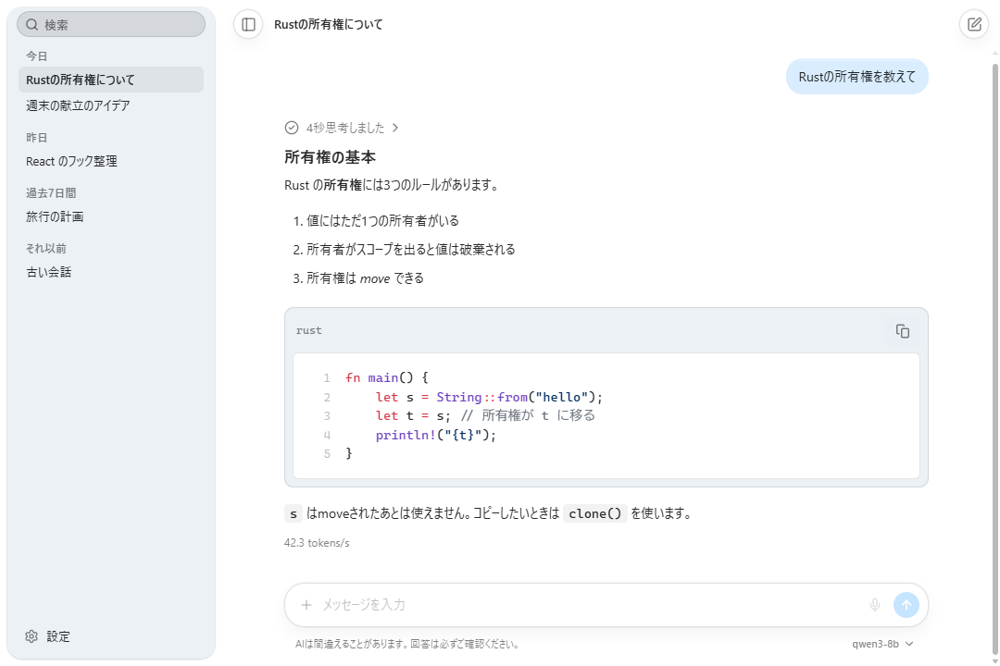
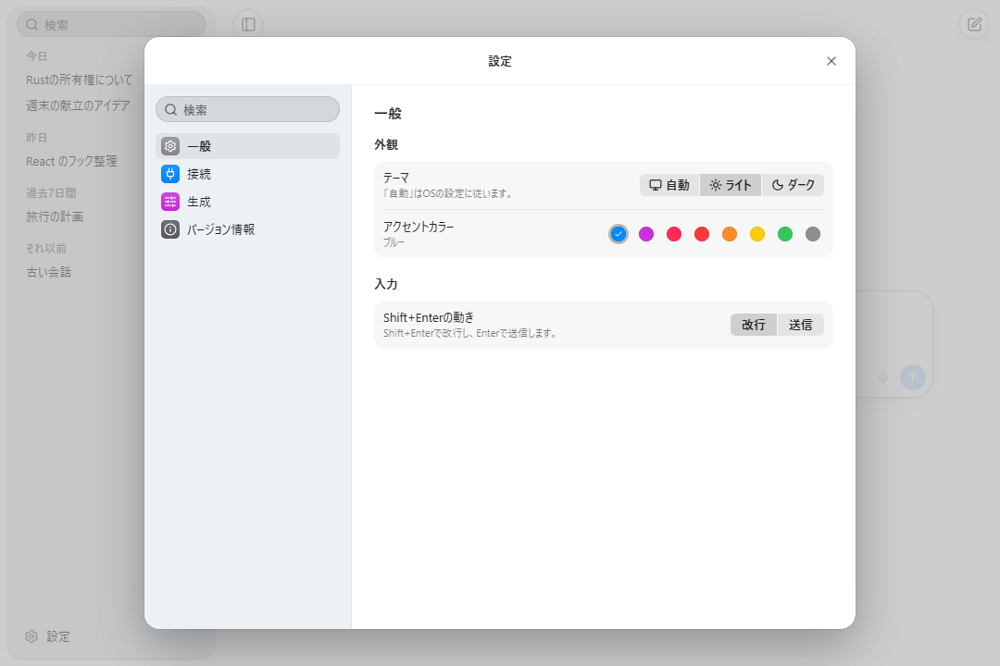
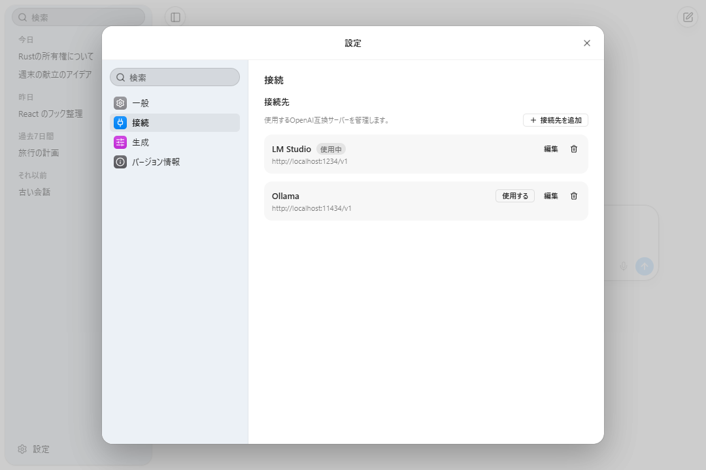
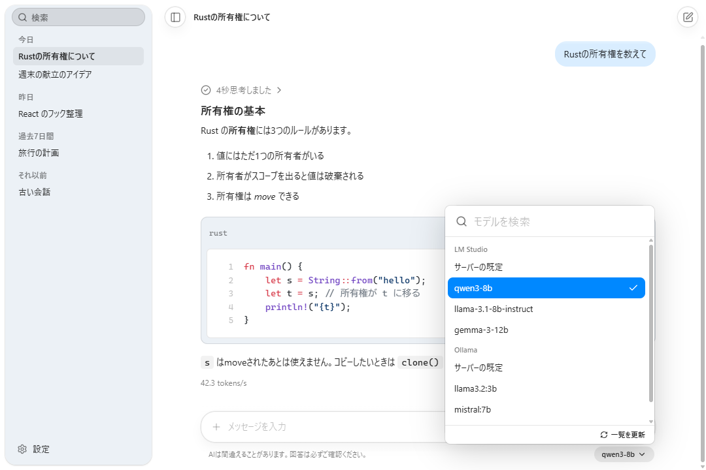

<div align="center">

<picture>
  <source media="(prefers-color-scheme: dark)" srcset="assets/icon/open-ui-light.svg">
  
</picture>

# open-ui

**A desktop chat app for talking comfortably with AI running on your own PC.**<br>
Just connect it to any OpenAI-compatible server, such as LM Studio, Ollama, llama.cpp, or vLLM.

[](LICENSE)
[](https://github.com/Harukotokoto/open-ui/releases/latest)


[Download](https://github.com/Harukotokoto/open-ui/releases/latest) · [Features](#features) · [Install](#install) · [Getting started](#getting-started) · [Usage](#usage) · [Troubleshooting](#troubleshooting) · [Roadmap](#roadmap)

[日本語](README.md) · [English](README.en.md) · [한국어](README.ko.md)

<picture>
  <source media="(prefers-color-scheme: dark)" srcset="assets/screenshots/chat-dark.png">
  
</picture>

</div>

---

## Overview

open-ui is an app that gives you a comfortable chat interface for AI servers running on your own PC or network. It does not bundle any AI models. You run a model with a tool such as LM Studio or Ollama, and open-ui connects to that server.

- **Install and start using it**: a desktop app for Windows, macOS, and Linux.
- **Your conversations stay on your PC**: history and settings are stored locally. The app only talks to the server you set up.
- **Clear and responsive**: light and dark themes, and replies appear in real time.

> [!NOTE]
> This project is under development. Basic chat, history, multiple connections, file attachments, and auto-update all work. Features that are not available yet are listed in the [roadmap](#roadmap).

## Features

- **Real-time display**: replies appear as they arrive, and you can stop generation at any time.
- **Reasoning display**: for models that return their reasoning, it is shown in a separate collapsible block along with how long it took.
- **Readable replies**: syntax-highlighted code with a copy button, tables, math, and diagrams (Mermaid). Japanese and other CJK text renders correctly.
- **File attachments**: give it text or code, images, and PDFs by drag and drop, paste, or the file picker.
- **Multiple connections**: register LM Studio, Ollama, llama.cpp, vLLM, or any other OpenAI-compatible server, and switch between them.
- **Searchable model picker**: models from every connection are gathered into one list that you can filter by typing.
- **Conversation history**: saved automatically. The AI titles each conversation, and you can search, rename, and delete.
- **Output speed**: a speed such as `42.3 tokens/s` is shown under each reply.
- **Auto-update**: the app tells you when a new version is out, and updates and restarts once you approve.
- **Appearance**: light, dark, or automatic, with eight accent colors. It also works in narrow windows.

## Screenshots

| Settings (General)                                                                               | Settings (Connection)                                                                        |
| ------------------------------------------------------------------------------------------------ | -------------------------------------------------------------------------------------------- |
|  |  |

| Model picker                                                                           |
| -------------------------------------------------------------------------------------- |
|  |

## Install

Download the file for your OS from "Assets" in the [latest release](https://github.com/Harukotokoto/open-ui/releases/latest). `<version>` stands for the release number.

| OS      | File to download                                                                                       |
| ------- | ------------------------------------------------------------------------------------------------------ |
| Windows | `open-ui_<version>_x64-setup.exe` (installer) or `open-ui_<version>_x64_en-US.msi`                     |
| macOS   | `open-ui_<version>_universal.dmg` (works on both Apple Silicon and Intel)                              |
| Linux   | `open-ui_<version>_amd64.AppImage`, `open-ui_<version>_amd64.deb`, or `open-ui-<version>-1.x86_64.rpm` |

Once installed, the app checks for a new version at startup. You can also check manually from "About" in the settings.

> [!WARNING]
> The app is not code-signed for any OS. You may see a warning the first time you open it:
>
> - **Windows**: if you see "Windows protected your PC", choose "More info" → "Run anyway".
> - **macOS**: if you see "cannot verify the developer", close the dialog, open "System Settings" → "Privacy & Security", and choose "Open Anyway".
> - **Linux (AppImage)**: make the file executable before launching it (`chmod +x open-ui_*.AppImage`).

## Getting started

1. **Prepare and start an AI server.** Anything that provides an OpenAI-compatible API works, such as LM Studio or Ollama. Follow each tool's instructions to download a model and start its server.
2. **Set up the connection in open-ui.** Open "Settings" at the bottom left, then "Connection". On first launch, one LM Studio connection (`http://localhost:1234/v1`) is already there. Add other servers with "Add connection" by picking a preset.
3. **Pick a model and start talking.** Click the model name at the bottom right of the input box, choose a model, and send a message.

The default URLs of the presets are below. If you changed the port, edit the URL.

| Preset    | Base URL                             |
| --------- | ------------------------------------ |
| LM Studio | `http://localhost:1234/v1`           |
| Ollama    | `http://localhost:11434/v1`          |
| llama.cpp | `http://localhost:8080/v1`           |
| vLLM      | `http://localhost:8000/v1`           |
| Custom    | `http://localhost:8080/v1` (edit it) |

"Test connection" in the connection editor checks whether the server is reachable. When it is, the models it found appear as suggestions. If your server needs an API key, enter it on the same screen.

## Usage

### Chat

- Press `Enter` to send and `Shift+Enter` for a new line. You can swap the two in Settings → General → Input.
- Pressing `Enter` to confirm an IME conversion does not send the message.
- While generating, the send button turns into a stop button. Generation continues even if you switch to another conversation.
- For models that return reasoning, "Thought for N seconds" appears above the reply. Click it to read the reasoning. Reasoning is not sent back to the server.
- The app automatically adds instructions about the formatting it can display, so the AI knows what to use.

### Attaching files

Pick files with the "+" button in the input box, drop them onto the window, or paste images and files.

| Type                          | How it is passed                                                                                                  |
| ----------------------------- | ----------------------------------------------------------------------------------------------------------------- |
| Text and code (UTF-8)         | Inserted before your message, with the file name                                                                  |
| Images (PNG, JPEG, GIF, WebP) | Sent as images. Images with a long edge over 2048px are scaled down. **A model that supports images is required** |
| PDF                           | The text is extracted and inserted. PDFs that are only scanned images have no text to extract                     |

Each file can be up to 10 MB, with up to 10 files and 25 MB in total per message. The type is detected from the content, not the extension.

### History

- Conversations are listed in the sidebar by date (Today / Yesterday / Previous 7 days / Older).
- Use the search box at the top to find a conversation by title.
- The "…" next to a conversation lets you rename or delete it (with confirmation).
- After the first exchange, the AI gives the conversation a title. If that fails, the first message becomes the title.

### Settings

Open them from "Settings" at the bottom left (`Ctrl+,` / `⌘,`). You can also search inside the settings.

| Category   | What you can do                                                                                      |
| ---------- | ---------------------------------------------------------------------------------------------------- |
| General    | Theme (Auto / Light / Dark), accent color, Shift+Enter behavior                                      |
| Connection | Add, edit, delete, and switch connections; set API keys; test the connection                         |
| Generation | System prompt, temperature, max tokens (shared by all conversations; empty means the server default) |
| About      | Check the version and look for updates                                                               |

### Shortcuts

On macOS, use `⌘` instead of `Ctrl`.

| Action             | Keys     |
| ------------------ | -------- |
| New chat           | `Ctrl+N` |
| Search history     | `Ctrl+F` |
| Toggle the sidebar | `Ctrl+B` |
| Open settings      | `Ctrl+,` |

## Privacy and security

- **Conversations and settings stay on your PC.** They are saved in the app's data folder, one file per conversation. Nothing is sent to the cloud.
- **The only server it talks to is the one you set up.** No usage data (telemetry) is sent. The one exception is the update check, which asks the GitHub releases.
- **API keys go into your OS's secure storage**: Windows Credential Manager, macOS Keychain, or the Linux Secret Service. They are not written to settings files.
- **External images in replies are not loaded, and links do not navigate.** This prevents images or links planted in a reply from leaking information.
- Update files are verified with a signature.

The data folder is here:

| OS      | Location                                                           |
| ------- | ------------------------------------------------------------------ |
| Windows | `%APPDATA%\io.github.harukoto-project.open-ui`                     |
| macOS   | `~/Library/Application Support/io.github.harukoto-project.open-ui` |
| Linux   | `~/.local/share/io.github.harukoto-project.open-ui`                |

## Troubleshooting

**The connection test fails, or no models appear**<br>
Check that the server is running, that the port in the URL is correct, and that the URL ends with `/v1`. If the server needs an API key, enter it too.

**The model list shows "Could not get the model list."**<br>
The reason appears inside that connection's group. Make sure the server is running, then press "Retry" or "Refresh list" at the bottom of the list. Models from other connections stay usable.

**I attached an image but the AI cannot read it**<br>
You need a model that supports images. A text-only model cannot understand images.

**Replies stop partway**<br>
Check that "Max tokens" in Settings → Generation is not too small. Leave it empty to use the server default.

**Cannot check for updates**<br>
Make sure you are online. If it keeps failing, you can reinstall the latest file from the [releases page](https://github.com/Harukotokoto/open-ui/releases/latest). Your conversations are kept.

Report bugs and requests in [Issues](https://github.com/Harukotokoto/open-ui/issues).

## Roadmap

| Status  | Item                                                                                                                                         |
| ------- | -------------------------------------------------------------------------------------------------------------------------------------------- |
| Done    | Chat, reasoning display, Markdown rendering, multiple connections, searchable model picker, history, file attachments, settings, auto-update |
| Coming  | Voice input (the microphone button in the input box is not usable yet)                                                                       |
| Not yet | Anthropic API support                                                                                                                        |
| Not yet | Personalization, memory, MCP                                                                                                                 |
| Not yet | Subtle animations                                                                                                                            |
| Not yet | A translated interface (English and Korean)                                                                                                  |

## Contributing

<details>
<summary>Build from source and development commands</summary>

### Requirements

- Node.js 22 or later
- pnpm (see `packageManager` in `package.json`)
- Rust (stable)
- The [Tauri prerequisites](https://v2.tauri.app/start/prerequisites/). On Linux: `libwebkit2gtk-4.1-dev`, `libappindicator3-dev`, `librsvg2-dev`, `patchelf`, and so on

### Build

```bash
git clone https://github.com/Harukotokoto/open-ui.git
cd open-ui
pnpm install

# Run for development (the frontend is at localhost:1420)
pnpm tauri dev

# Build installers
pnpm tauri build
```

### Commands

| Purpose             | Command                                                      |
| ------------------- | ------------------------------------------------------------ |
| Format              | `pnpm format` (Biome), `pnpm rust:fmt`                       |
| Lint and type check | `pnpm lint`, `pnpm typecheck`, `pnpm rust:lint`              |
| Test                | `pnpm test` (Vitest), `pnpm rust:test`                       |
| Generate IPC types  | `pnpm bindings` (updates `src/types/bindings.ts`; commit it) |

- Rust commands refer to Tauri's build output (`dist/`), so run `pnpm build` before `cargo clippy` or `cargo test`.
- On Windows, unit tests of crates that link Tauri do not start. Logic that needs Rust tests lives in `crates/core/`.
- `src/components/ui/` is generated by the UI component library, so do not edit it directly.

### Layout

The WebView (React) only handles display and input. Communication with the server, API keys, and file I/O are handled by Rust.

| Directory            | Contents                                                                                        |
| -------------------- | ----------------------------------------------------------------------------------------------- |
| `src/`               | Frontend (React): `components/`, `hooks/`, `services/`, `pages/`                                |
| `crates/core/`       | Tauri-independent Rust logic and types (API, profiles, history, settings, attachments, secrets) |
| `src-tauri/`         | The Tauri app: command entry points and IPC type generation                                     |
| `assets/`            | App icon SVGs and the screenshots used in the README                                            |
| `.github/workflows/` | CI and release workflows                                                                        |

### Releasing

Bump the version in all three places (`package.json`, `src-tauri/tauri.conf.json`, `Cargo.toml`) and push a `v*` tag. GitHub Actions builds signed installers for the three OSes and creates a draft release. Once you publish the draft, the app's auto-update finds the new version.

</details>

## License

[MIT License](LICENSE)
