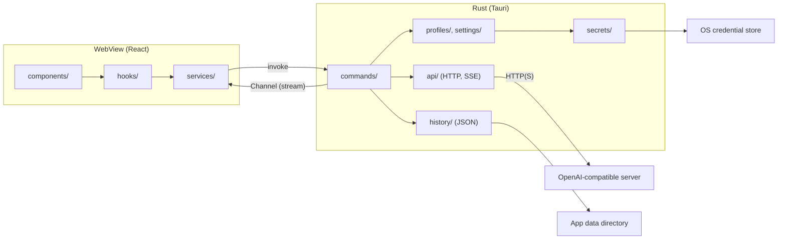

<div align="center">

<picture>
  <source media="(prefers-color-scheme: dark)" srcset="assets/icon/open-ui-light.svg">
  
</picture>

# open-ui

**A UI-only desktop chat app for OpenAI-compatible AI servers such as LM Studio, Ollama, llama.cpp, and vLLM.**

[](LICENSE)
[](https://github.com/Harukotokoto/open-ui/actions/workflows/ci.yml)


[Overview](#overview) · [Features](#features) · [How it works](#how-it-works) · [Requirements](#requirements) · [Setup](#setup) · [Development](#development) · [Roadmap](#roadmap) · [License](#license)

[日本語](README.md) · [English](README.en.md) · [한국어](README.ko.md)

</div>

---

## Overview

open-ui is a desktop app that gives you a comfortable chat interface for AI servers running on your own PC or network. It does not bundle any models. It connects to a server that provides an OpenAI-compatible API (`/chat/completions` and `/models`).

- A native app built with Rust and Tauri, targeting Windows, macOS, and Linux equally.
- The interface is built with React and shadcn/ui, with light and dark themes.
- All networking and API key handling happens on the Rust side. Keys are never passed to the WebView.

> [!NOTE]
> This project is under development. Basic chat, history, connection profiles, Markdown rendering, and auto-update work. Attachments, Anthropic API support, memory, and MCP are not implemented yet (see the [Roadmap](#roadmap)).

## Features

### Chat

- **Streaming**: Replies are displayed as they arrive. While a reply is being generated, the send button turns into a stop button.
- **Reasoning display**: For models that return `reasoning_content` or `reasoning`, the reasoning is shown in a collapsible block separate from the reply. Reasoning is never sent back to the server.
- **Markdown rendering**: Syntax-highlighted code, Mermaid diagrams, math (KaTeX), and CJK text are supported. A custom tag, `<callout type="note|tip|warning|danger">`, is available for notices.
- **Output speed**: A small `42.3 tokens/s` line is shown under each reply. If the server does not report token counts, the number of received data chunks is used instead and shown as approximate.
- **Format hints for the AI**: A description of the formats the screen can render is automatically appended to the system prompt.

### Connections and models

- **Multiple profiles**: Add a connection from the LM Studio, Ollama, llama.cpp, vLLM, or Custom presets. The name, URL, and API key can be edited afterward.
- **Connection test**: From a profile's edit form, check whether the server is reachable. When it is, the models found are offered as candidates.
- **Searchable model picker**: Models from all profiles are listed and can be filtered by space-separated partial matches. Choosing a model from another profile also switches the active profile. If fetching fails for a profile, the reason and a retry button appear inside that profile's group.

### History

- **Autosave**: Conversations are saved right after you send, when a reply finishes, and when you leave the screen. Each conversation is one JSON file.
- **Sidebar**: New chat, title search, date groups (Today / Yesterday / Previous 7 days / Older), rename, and delete (with confirmation).
- **AI-generated titles**: After the first exchange, the model is asked to write a title. If that fails, the title made from the first message is kept.

### Settings and more

- **Settings dialog**: Appearance (follow system / light / dark), connections, and generation (system prompt, temperature, max tokens). Search within settings is supported.
- **Auto-update**: Checks for a new version at launch and, once you approve, updates and restarts. Update files are verified by signature. Development builds do not check.
- **Responsive**: The minimum window size is 640×480, and the sidebar becomes an off-canvas panel at narrow widths.

## How it works

The WebView handles display and input only. Communication with the server, API keys, and file I/O are handled by Rust.



### Where data is stored

| Data                                            | Location                                                                                     |
| ----------------------------------------------- | -------------------------------------------------------------------------------------------- |
| Settings and connection profiles (without keys) | `settings.json` in the app data directory                                                    |
| Chat history                                    | `history/<id>.json` in the app data directory                                                |
| API keys                                        | The OS credential store (Windows Credential Manager / macOS Keychain / Linux Secret Service) |

### Security

- There is no command that returns an API key. The WebView can only set a key, delete it, and check whether one is saved.
- Tauri permissions are kept to a minimum. The HTTP, shell, and filesystem plugins are not used.
- External images in Markdown are not loaded, and links do not navigate.

### Project layout

| Directory            | Contents                                                                                                 |
| -------------------- | -------------------------------------------------------------------------------------------------------- |
| `src/`               | Frontend (React): `components/` (display), `hooks/` (state), `services/` (IPC calls), `pages/`           |
| `crates/core/`       | Tauri-independent Rust logic and types (API, profiles, history, settings, secrets). Rust tests live here |
| `src-tauri/`         | The Tauri app: command entry points and IPC type generation                                              |
| `assets/icon/`       | App icon SVGs                                                                                            |
| `.github/workflows/` | CI and release workflows                                                                                 |

## Requirements

- An OpenAI-compatible server to connect to (LM Studio, Ollama, llama.cpp, vLLM, etc.)
- Windows / macOS / Linux (CI builds and tests all three)

To build the app yourself, you also need:

- Node.js 22 or later
- pnpm (`packageManager` in `package.json` is `pnpm@12.16.1`)
- Rust (stable)
- The [Tauri prerequisites](https://v2.tauri.app/start/prerequisites/). On Linux, this includes `libwebkit2gtk-4.1-dev`, `libappindicator3-dev`, `librsvg2-dev`, and `patchelf`

## Setup

### Using an installer

Installers are planned to be distributed through [GitHub Releases](https://github.com/Harukotokoto/open-ui/releases). Until they are published, use "Build from source" below.

> [!WARNING]
> Code signing and notarization for macOS are not supported yet. Gatekeeper will show a warning the first time you open a distributed build.

### Build from source

```bash
git clone https://github.com/Harukotokoto/open-ui.git
cd open-ui
pnpm install

# Run for development (the frontend serves on localhost:1420)
pnpm tauri dev

# Build installers
pnpm tauri build
```

### Getting started

1. Start your server (for example, LM Studio).
2. In open-ui, open the settings dialog, go to "Connection", and set the profile's URL and API key (if needed). On first launch, one LM Studio profile (`http://localhost:1234/v1`) is already set up.
3. Pick a model with the model picker at the bottom right of the input box, and send a message.

The preset default URLs are:

| Preset    | Base URL                                           |
| --------- | -------------------------------------------------- |
| LM Studio | `http://localhost:1234/v1`                         |
| Ollama    | `http://localhost:11434/v1`                        |
| llama.cpp | `http://localhost:8080/v1`                         |
| vLLM      | `http://localhost:8000/v1`                         |
| Custom    | `http://localhost:8080/v1` (meant to be rewritten) |

## Development

| Purpose             | Command                                                               |
| ------------------- | --------------------------------------------------------------------- |
| Frontend dev server | `pnpm dev`                                                            |
| Run the app         | `pnpm tauri dev`                                                      |
| Format              | `pnpm format` (Biome), `pnpm rust:fmt`                                |
| Lint and type check | `pnpm lint`, `pnpm typecheck`, `pnpm rust:lint`                       |
| Test                | `pnpm test` (Vitest), `pnpm rust:test`                                |
| Generate IPC types  | `pnpm bindings` (updates `src/types/bindings.ts`, which is committed) |

- Rust commands refer to Tauri's build output (`dist/`), so run `pnpm build` before `cargo clippy` or `cargo test`.
- On Windows, unit tests in crates that link Tauri do not start. For that reason, Rust logic that needs tests lives in `crates/core/`.
- `src/components/ui/` is generated by shadcn/ui and is not edited directly.

### Releasing

Bump the version in all three places (`package.json`, `src-tauri/tauri.conf.json`, and `Cargo.toml`) so they match, then push a `v*` tag. GitHub Actions builds signed installers for the three operating systems and creates a draft release. Once you publish the draft, the app's auto-update picks up the new version.

## Roadmap

| Status          | Contents                                                                                                                                        |
| --------------- | ----------------------------------------------------------------------------------------------------------------------------------------------- |
| Done            | Basic chat, Welcome screen, sidebar and history, settings dialog, connection profiles, searchable model picker, Markdown rendering, auto-update |
| Not implemented | Attachments (text, images, PDF) and voice input (the "+" button in the input box stays disabled)                                                |
| Not implemented | Anthropic API support                                                                                                                           |
| Not implemented | Personalization, memory, MCP                                                                                                                    |
| Not implemented | Light animations                                                                                                                                |

## License

[MIT License](LICENSE)
