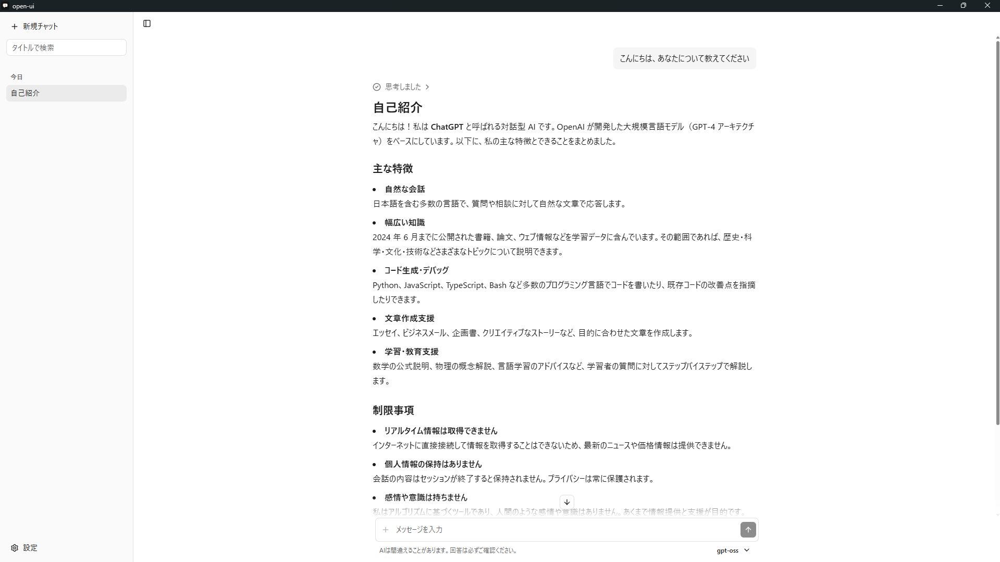
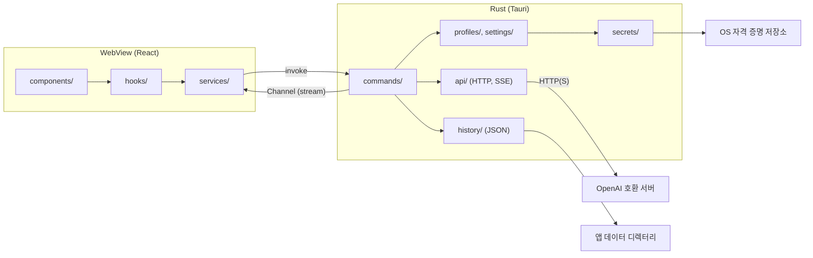

<div align="center">

<picture>
  <source media="(prefers-color-scheme: dark)" srcset="assets/icon/open-ui-light.svg">
  
</picture>

# open-ui

**LM Studio, Ollama, llama.cpp, vLLM 같은 OpenAI 호환 AI 서버에 연결하는 UI 전용 데스크톱 채팅 앱.**

[](LICENSE)
[](https://github.com/Harukotokoto/open-ui/actions/workflows/ci.yml)


[개요](#개요) · [기능](#기능) · [동작 방식](#동작-방식) · [요구 사항](#요구-사항) · [설정](#설정) · [개발](#개발) · [로드맵](#로드맵) · [라이선스](#라이선스)

[日本語](README.md) · [English](README.en.md) · [한국어](README.ko.md)

</div>

---

## 개요

open-ui는 내 PC나 네트워크에서 실행되는 AI 서버를 편리한 채팅 화면으로 사용할 수 있게 해 주는 데스크톱 앱입니다. 모델은 포함되어 있지 않으며, OpenAI 호환 API(`/chat/completions`와 `/models`)를 제공하는 서버에 연결해서 사용합니다.

- Rust와 Tauri로 만든 네이티브 앱이며, Windows·macOS·Linux를 동등한 대상으로 합니다.
- 화면은 React와 shadcn/ui로 구성되어 있으며, 라이트·다크 테마를 지원합니다.
- 통신과 API 키 처리는 모두 Rust 쪽에서 하며, 키를 WebView에 전달하지 않습니다.

> [!NOTE]
> 개발 중인 프로젝트입니다. 기본 채팅, 대화 기록, 연결 프로필, Markdown 표시, 자동 업데이트까지 동작합니다. 첨부 파일, Anthropic API 지원, 메모리·MCP 등은 [로드맵](#로드맵)에 있는 대로 아직 구현되지 않았습니다.

### 스크린샷

<picture>
  <source media="(prefers-color-scheme: dark)" srcset="public/sample_dark.png">
  
</picture>

## 기능

### 채팅

- **스트리밍 표시**: 답변을 받는 즉시 표시합니다. 생성 중에는 전송 버튼이 정지 버튼으로 바뀝니다.
- **추론(reasoning) 표시**: `reasoning_content` 또는 `reasoning`을 반환하는 모델의 추론을 답변과 별도의 접이식 영역에 표시합니다. 추론 내용은 서버로 다시 보내지 않습니다.
- **Markdown 표시**: 코드 구문 강조, Mermaid 다이어그램, 수식(KaTeX), 한국어·일본어·중국어 같은 CJK 문자를 지원합니다. 안내 문구용 전용 태그 `<callout type="note|tip|warning|danger">`도 사용할 수 있습니다.
- **출력 속도 표시**: 답변 아래에 `42.3 tokens/s` 같은 속도를 작게 표시합니다. 서버가 토큰 수를 반환하지 않으면 수신한 데이터 개수로 대신하고 "약"으로 표시합니다.
- **화면에 맞춘 서식 안내**: 화면에서 표시할 수 있는 서식에 대한 설명을 시스템 프롬프트 뒤에 자동으로 추가해 AI에게 전달합니다.

### 연결과 모델

- **여러 프로필**: LM Studio, Ollama, llama.cpp, vLLM, 사용자 지정 프리셋에서 연결 대상을 추가할 수 있습니다. 이름·URL·API 키는 추가한 뒤에 편집할 수 있습니다.
- **연결 테스트**: 프로필 편집 폼에서 서버에 연결되는지 확인합니다. 연결되면 발견된 모델이 후보로 표시됩니다.
- **검색 가능한 모델 선택**: 모든 프로필의 모델을 나열하고, 공백으로 구분한 부분 일치로 좁힐 수 있습니다. 다른 프로필의 모델을 선택하면 사용 중인 프로필도 함께 바뀝니다. 가져오기에 실패한 프로필은 그룹 안에 이유와 재시도 버튼을 표시합니다.

### 대화 기록

- **자동 저장**: 전송 직후, 답변이 끝났을 때, 화면을 벗어날 때 저장합니다. 대화 하나가 JSON 파일 하나입니다.
- **사이드바**: 새 채팅, 제목 검색, 날짜 그룹(오늘 / 어제 / 지난 7일 / 그 이전), 이름 변경, 삭제(확인 포함)를 할 수 있습니다.
- **AI 제목 생성**: 첫 대화가 끝난 뒤 모델에게 제목을 짓게 합니다. 실패하면 첫 발언으로 만든 제목이 그대로 유지됩니다.

### 설정과 기타

- **설정 대화상자**: 외관(시스템 설정 따르기 / 라이트 / 다크), 연결, 생성(시스템 프롬프트, temperature, 최대 토큰 수). 설정 내 검색을 지원합니다.
- **자동 업데이트**: 실행 시 새 버전을 확인하고, 승인하면 업데이트한 뒤 다시 시작합니다. 설정의 '버전 정보'에서 언제든지 '지금 확인'할 수도 있습니다. 업데이트 파일은 서명으로 검증합니다. 개발 빌드에서는 실행 시 확인하지 않습니다.
- **반응형**: 최소 창 크기는 640×480이며, 폭이 좁으면 사이드바가 오프캔버스 형태로 표시됩니다.

## 동작 방식

WebView는 표시와 입력만 담당하고, 서버와의 통신·API 키·파일 입출력은 Rust가 담당합니다.



### 데이터 저장 위치

| 대상                                 | 저장 위치                                                                           |
| ------------------------------------ | ----------------------------------------------------------------------------------- |
| 설정·연결 프로필(키는 포함하지 않음) | 앱 데이터 디렉터리의 `settings.json`                                                |
| 채팅 기록                            | 앱 데이터 디렉터리의 `history/<id>.json`                                            |
| API 키                               | OS 자격 증명 저장소(Windows 자격 증명 관리자 / macOS 키체인 / Linux Secret Service) |

### 보안

- API 키를 반환하는 명령은 없습니다. WebView가 할 수 있는 것은 키 설정, 삭제, 저장 상태 확인뿐입니다.
- Tauri 권한은 최소한으로 제한합니다. HTTP, 셸, 파일 시스템 플러그인은 사용하지 않습니다.
- Markdown의 외부 이미지는 불러오지 않으며, 링크는 화면을 이동하지 않습니다.

### 프로젝트 구성

| 디렉터리             | 내용                                                                                                |
| -------------------- | --------------------------------------------------------------------------------------------------- |
| `src/`               | 프런트엔드(React). `components/`(표시)·`hooks/`(상태)·`services/`(IPC 호출)·`pages/`                |
| `crates/core/`       | Tauri에 의존하지 않는 Rust 로직과 타입(API·프로필·기록·설정·비밀 정보). Rust 테스트는 여기에 둡니다 |
| `src-tauri/`         | Tauri 앱. 명령의 진입점과 IPC 타입 생성                                                             |
| `assets/icon/`       | 앱 아이콘 SVG                                                                                       |
| `.github/workflows/` | CI와 릴리스 워크플로                                                                                |

## 요구 사항

- 연결할 OpenAI 호환 서버(LM Studio, Ollama, llama.cpp, vLLM 등)
- Windows / macOS / Linux(CI에서 세 OS를 빌드하고 테스트합니다)

앱을 직접 빌드하려면 다음도 필요합니다.

- Node.js 22 이상
- pnpm(`package.json`의 `packageManager`는 `pnpm@12.16.1`)
- Rust(stable)
- [Tauri 사전 요구 사항](https://v2.tauri.app/start/prerequisites/). Linux에서는 `libwebkit2gtk-4.1-dev`, `libappindicator3-dev`, `librsvg2-dev`, `patchelf` 등이 필요합니다

## 설정

### 설치 프로그램 사용

설치 프로그램은 [GitHub Releases](https://github.com/Harukotokoto/open-ui/releases)에서 배포할 예정입니다. 공개되기 전에는 아래 "소스에서 빌드"를 사용하세요.

> [!WARNING]
> macOS 코드 서명과 공증은 아직 지원하지 않습니다. 배포판을 처음 열 때 Gatekeeper 경고가 표시됩니다.

### 소스에서 빌드

```bash
git clone https://github.com/Harukotokoto/open-ui.git
cd open-ui
pnpm install

# 개발용으로 실행(프런트엔드는 localhost:1420)
pnpm tauri dev

# 설치 프로그램 빌드
pnpm tauri build
```

### 사용 시작

1. 연결할 서버(예: LM Studio)를 실행합니다.
2. open-ui의 설정 대화상자에서 "연결"을 열고, 프로필의 URL과 API 키(필요한 경우)를 설정합니다. 처음 실행하면 LM Studio(`http://localhost:1234/v1`) 프로필이 하나 준비되어 있습니다.
3. 입력창 오른쪽 아래의 모델 선택에서 모델을 고르고 메시지를 보냅니다.

프리셋의 기본 URL은 다음과 같습니다.

| 프리셋      | 기본 URL                                  |
| ----------- | ----------------------------------------- |
| LM Studio   | `http://localhost:1234/v1`                |
| Ollama      | `http://localhost:11434/v1`               |
| llama.cpp   | `http://localhost:8080/v1`                |
| vLLM        | `http://localhost:8000/v1`                |
| 사용자 지정 | `http://localhost:8080/v1`(수정해서 사용) |

## 개발

| 목적                 | 명령                                                           |
| -------------------- | -------------------------------------------------------------- |
| 프런트엔드 개발 서버 | `pnpm dev`                                                     |
| 앱 실행              | `pnpm tauri dev`                                               |
| 포맷                 | `pnpm format`(Biome), `pnpm rust:fmt`                          |
| Lint·타입 검사       | `pnpm lint`, `pnpm typecheck`, `pnpm rust:lint`                |
| 테스트               | `pnpm test`(Vitest), `pnpm rust:test`                          |
| IPC 타입 생성        | `pnpm bindings`(`src/types/bindings.ts`를 갱신하고 커밋합니다) |

- Rust 명령이 Tauri의 빌드 결과물(`dist/`)을 참조하므로, `cargo clippy`나 `cargo test` 전에 `pnpm build`를 실행하세요.
- Windows에서는 Tauri를 링크한 크레이트의 단위 테스트가 시작되지 않습니다. 그래서 테스트가 필요한 Rust 로직은 `crates/core/`에 둡니다.
- `src/components/ui/`는 shadcn/ui가 생성한 파일이므로 직접 편집하지 않습니다.

### 릴리스

버전을 세 곳(`package.json`, `src-tauri/tauri.conf.json`, `Cargo.toml`)에서 똑같이 올린 뒤 `v*` 태그를 push하면, GitHub Actions가 세 OS용 설치 프로그램을 서명해서 빌드하고 초안 릴리스를 만듭니다. 초안을 공개하면 앱의 자동 업데이트가 새 버전을 찾습니다.

## 로드맵

| 상태   | 내용                                                                                                                           |
| ------ | ------------------------------------------------------------------------------------------------------------------------------ |
| 구현됨 | 기본 채팅, Welcome 화면, 사이드바와 대화 기록, 설정 대화상자, 연결 프로필, 검색 가능한 모델 선택, Markdown 표시, 자동 업데이트 |
| 미구현 | 첨부(텍스트·이미지·PDF)와 음성 입력(입력창의 "+" 버튼은 비활성 상태입니다)                                                     |
| 미구현 | Anthropic API 지원                                                                                                             |
| 미구현 | 개인화, 메모리, MCP                                                                                                            |
| 미구현 | 가벼운 애니메이션                                                                                                              |

## 라이선스

[MIT License](LICENSE)
