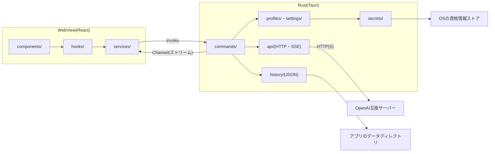

<div align="center">

<picture>
  <source media="(prefers-color-scheme: dark)" srcset="assets/icon/open-ui-light.svg">
  
</picture>

# open-ui

**OpenAI互換のAIサーバー(LM Studio、Ollama、llama.cpp、vLLMなど)につなぐ、UIだけのデスクトップチャットアプリ。**

[](LICENSE)
[](https://github.com/Harukotokoto/open-ui/actions/workflows/ci.yml)


[概要](#概要) · [機能](#機能) · [仕組み](#仕組み) · [動作要件](#動作要件) · [セットアップ](#セットアップ) · [開発](#開発) · [ロードマップ](#ロードマップ) · [ライセンス](#ライセンス)

[日本語](README.md) · [English](README.en.md) · [한국어](README.ko.md)

</div>

---

## 概要

open-uiは、自分のPCやネットワーク上で動くAIサーバーを、使いやすいチャット画面から操作するためのデスクトップアプリです。モデルそのものは同梱せず、OpenAI互換のAPI(`/chat/completions` と `/models`)を持つサーバーに接続して使います。

- RustとTauriで作られたネイティブアプリで、Windows・macOS・Linuxを同等の対象にしています。
- 画面はReactとshadcn/uiで構成し、ライト・ダークのテーマに対応しています。
- 通信とAPIキーの扱いはすべてRust側で行い、キーをWebViewに渡しません。

> [!NOTE]
> 開発中のプロジェクトです。基本のチャット、履歴、接続プロファイル、Markdown表示、自動更新までが動きます。添付ファイル、Anthropic API対応、メモリ・MCPなどは[ロードマップ](#ロードマップ)のとおり未実装です。

## 機能

### チャット

- **ストリーミング表示**: 返答を受信しながら表示します。生成中は送信ボタンが停止ボタンに変わります。
- **思考(reasoning)の表示**: `reasoning_content` または `reasoning` を返すモデルの思考を、返答とは別の折りたたみ枠で表示します。思考はサーバーに送り返しません。
- **Markdown表示**: コードのシンタックスハイライト、Mermaid図、数式(KaTeX)、日本語などのCJK文字に対応します。注意書き用の独自タグ `<callout type="note|tip|warning|danger">` も使えます。
- **出力速度の表示**: 返答の下に `42.3 tokens/s` のような速度を小さく添えます。サーバーがトークン数を返さないときは、受信したデータの数で代用し「約」と表示します。
- **画面に合わせた書式の指示**: 表示できる書式の説明を、システムプロンプトの後ろに自動で足してAIに伝えます。

### 接続とモデル

- **複数のプロファイル**: LM Studio、Ollama、llama.cpp、vLLM、カスタムのプリセットから接続先を追加できます。名前・URL・APIキーは追加後に編集できます。
- **接続テスト**: プロファイルの編集フォームから、サーバーにつながるかを確かめます。つながると、見つかったモデルが候補に出ます。
- **検索付きのモデル選択**: 全プロファイルのモデルを一覧し、空白区切りの部分一致で絞り込めます。別のプロファイルのモデルを選ぶと、使用中のプロファイルも切り替わります。取得に失敗したプロファイルは、理由と再試行をグループ内に表示します。

### 履歴

- **自動保存**: 送信直後、返答の終了時、画面から離れるときに保存します。1会話が1つのJSONファイルです。
- **サイドバー**: 新規チャット、タイトル検索、日付グループ(今日 / 昨日 / 過去7日間 / それ以前)、名前の変更、削除(確認つき)ができます。
- **AIによるタイトル生成**: 最初のやり取りが終わったあとに、モデルにタイトルを付けさせます。失敗したときは最初の発言から作ったタイトルのままです。

### 設定・その他

- **設定ダイアログ**: 外観(システムに従う / ライト / ダーク)、接続、生成(システムプロンプト、temperature、最大トークン数)。設定内の検索に対応します。
- **自動更新**: 起動時に新しいバージョンを確認し、承認すると更新して再起動します。設定の「バージョン情報」から、いつでも「今すぐ確認」できます。更新ファイルは署名で検証します。開発ビルドでは起動時に確認しません。
- **レスポンシブ**: 最小ウィンドウは640×480で、狭い幅ではサイドバーがオフキャンバスの表示になります。

## 仕組み

WebViewは表示と入力だけを担当し、サーバーとの通信、APIキー、ファイルの読み書きはRustが担当します。



### データの保存先

| 対象                                   | 保存先                                                                                 |
| -------------------------------------- | -------------------------------------------------------------------------------------- |
| 設定・接続プロファイル(キーは含まない) | アプリのデータディレクトリの `settings.json`                                           |
| チャット履歴                           | アプリのデータディレクトリの `history/<id>.json`                                       |
| APIキー                                | OSの資格情報(Windows 資格情報マネージャー / macOS キーチェーン / Linux Secret Service) |

### セキュリティ

- APIキーを返すコマンドはありません。WebViewが扱えるのは、キーの設定・削除・保存状態の確認だけです。
- Tauriの権限は最小限です。HTTP・シェル・ファイルシステムのプラグインは使っていません。
- Markdownの外部画像は読み込まず、リンクは画面遷移しません。

### プロジェクト構成

| ディレクトリ         | 内容                                                                                                   |
| -------------------- | ------------------------------------------------------------------------------------------------------ |
| `src/`               | フロントエンド(React)。`components/`(表示)・`hooks/`(状態)・`services/`(IPCの呼び出し)・`pages/`       |
| `crates/core/`       | Tauriに依存しないRustのロジックと型(API・プロファイル・履歴・設定・秘密情報)。Rustのテストはここに置く |
| `src-tauri/`         | Tauriのアプリ。コマンドの入口とIPCの型の生成                                                           |
| `assets/icon/`       | アプリアイコンのSVG                                                                                    |
| `.github/workflows/` | CIとリリースのワークフロー                                                                             |

## 動作要件

- 接続先のOpenAI互換サーバー(LM Studio、Ollama、llama.cpp、vLLM など)
- Windows / macOS / Linux(CIで3つのOSをビルド・テストしています)

アプリを自分でビルドする場合は、次も必要です。

- Node.js 22以上
- pnpm(`package.json` の `packageManager` は `pnpm@12.16.1`)
- Rust(stable)
- [Tauriの前提環境](https://v2.tauri.app/start/prerequisites/)。Linuxでは `libwebkit2gtk-4.1-dev`、`libappindicator3-dev`、`librsvg2-dev`、`patchelf` など

## セットアップ

### インストーラーを使う

インストーラーは[GitHub Releases](https://github.com/Harukotokoto/open-ui/releases)で配布する予定です。公開されるまでは、次の「ソースからビルドする」を使ってください。

> [!WARNING]
> macOSのコード署名・公証は未対応です。配布版を初めて開くときに、Gatekeeperの警告が出ます。

### ソースからビルドする

```bash
git clone https://github.com/Harukotokoto/open-ui.git
cd open-ui
pnpm install

# 開発用に起動する(フロントは localhost:1420)
pnpm tauri dev

# インストーラーを作る
pnpm tauri build
```

### 使い始める

1. 接続先のサーバー(例: LM Studio)を起動する。
2. open-uiの設定ダイアログの「接続」で、プロファイルのURLとAPIキー(必要な場合)を設定する。初回起動では、LM Studio(`http://localhost:1234/v1`)のプロファイルが1件用意されています。
3. 入力欄の右下のモデル選択でモデルを選び、メッセージを送る。

プリセットの初期URLは次のとおりです。

| プリセット | ベースURL                                      |
| ---------- | ---------------------------------------------- |
| LM Studio  | `http://localhost:1234/v1`                     |
| Ollama     | `http://localhost:11434/v1`                    |
| llama.cpp  | `http://localhost:8080/v1`                     |
| vLLM       | `http://localhost:8000/v1`                     |
| カスタム   | `http://localhost:8080/v1`(書き換えて使います) |

## 開発

| 目的                   | コマンド                                                        |
| ---------------------- | --------------------------------------------------------------- |
| フロントの開発サーバー | `pnpm dev`                                                      |
| アプリの起動           | `pnpm tauri dev`                                                |
| 整形                   | `pnpm format`(Biome)、`pnpm rust:fmt`                           |
| Lint・型チェック       | `pnpm lint`、`pnpm typecheck`、`pnpm rust:lint`                 |
| テスト                 | `pnpm test`(Vitest)、`pnpm rust:test`                           |
| IPCの型の生成          | `pnpm bindings`(`src/types/bindings.ts` を更新してコミットする) |

- RustのコマンドがTauriのビルド成果物(`dist/`)を参照するため、`cargo clippy` や `cargo test` の前に `pnpm build` を実行してください。
- Windowsでは、Tauriをリンクしたクレートの単体テストが起動しません。そのため、Rustのテストが必要なロジックは `crates/core/` に置いています。
- `src/components/ui/` はshadcn/uiの生成物なので、直接編集しません。

### リリース

バージョン3か所(`package.json`・`src-tauri/tauri.conf.json`・`Cargo.toml`)をそろえて上げ、`v*` のタグをpushすると、GitHub Actionsが3つのOS向けのインストーラーを署名つきでビルドし、ドラフトのリリースを作ります。ドラフトを公開すると、アプリの自動更新が新しいバージョンを見つけます。

## ロードマップ

| 状態     | 内容                                                                                                                        |
| -------- | --------------------------------------------------------------------------------------------------------------------------- |
| 実装済み | 基本チャット、Welcome画面、サイドバーと履歴、設定ダイアログ、接続プロファイル、検索付きのモデル選択、Markdown表示、自動更新 |
| 未実装   | 添付(テキスト・画像・PDF)とボイス入力(入力欄の「+」ボタンは無効のまま)                                                      |
| 未実装   | Anthropic APIへの対応                                                                                                       |
| 未実装   | パーソナライズ、メモリ、MCP                                                                                                 |
| 未実装   | 軽いアニメーション                                                                                                          |

## ライセンス

[MIT License](LICENSE)
