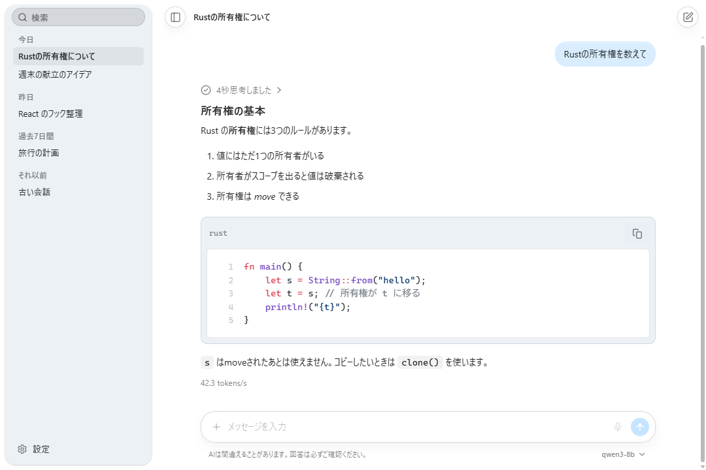
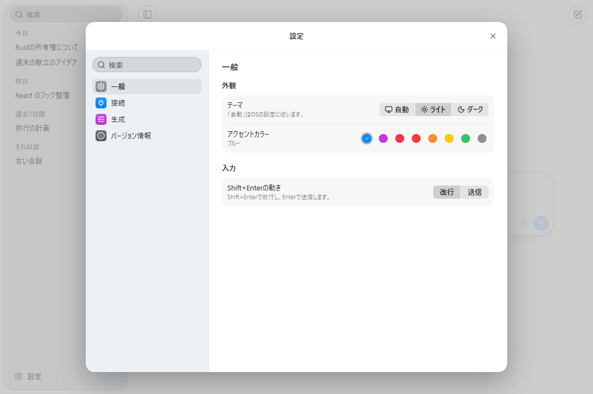
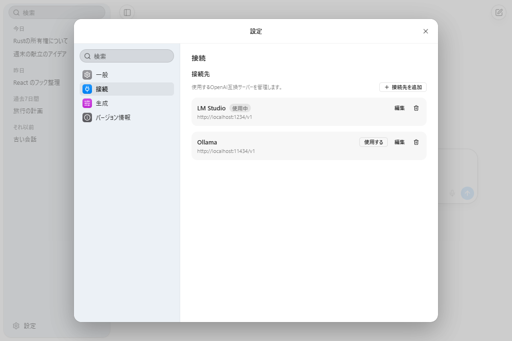
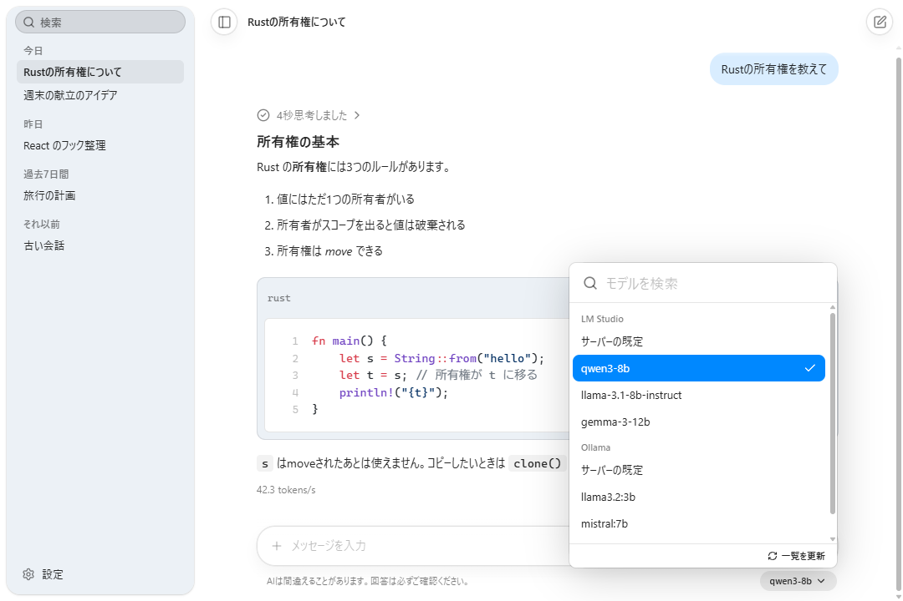

<div align="center">

<picture>
  <source media="(prefers-color-scheme: dark)" srcset="assets/icon/open-ui-light.svg">
  
</picture>

# open-ui

**自分のPCで動くAIと、気持ちよく会話するためのデスクトップチャットアプリ。**<br>
LM Studio、Ollama、llama.cpp、vLLMなど、OpenAI互換のサーバーにつなぐだけで使えます。

[](LICENSE)
[](https://github.com/Harukotokoto/open-ui/releases/latest)


[ダウンロード](https://github.com/Harukotokoto/open-ui/releases/latest) · [特長](#特長) · [インストール](#インストール) · [使い始める](#使い始める) · [使い方](#使い方) · [困ったとき](#困ったとき) · [ロードマップ](#ロードマップ)

[日本語](README.md) · [English](README.en.md) · [한국어](README.ko.md)

<picture>
  <source media="(prefers-color-scheme: dark)" srcset="assets/screenshots/chat-dark.png">
  
</picture>

</div>

---

## 概要

open-uiは、自分のPCやネットワーク上で動くAIサーバーを、使いやすいチャット画面から操作するためのアプリです。AIのモデルは同梱していません。LM StudioやOllamaなどでモデルを動かし、そのサーバーに接続して使います。

- **インストールしてすぐ使える**: Windows・macOS・Linuxのデスクトップアプリです。
- **会話はあなたのPCの中だけ**: 履歴や設定はPCに保存します。通信するのは、あなたが設定したサーバーだけです。
- **見やすく、軽快**: ライト・ダークのテーマに対応し、返答をリアルタイムに表示します。

> [!NOTE]
> 開発中のプロジェクトです。基本のチャット、履歴、複数の接続先、ファイルの添付、自動更新までが動きます。未対応の機能は[ロードマップ](#ロードマップ)にあります。

## 特長

- **リアルタイム表示**: 返答を受け取りながら表示します。生成中はいつでも止められます。
- **思考の表示**: 思考(reasoning)を返すモデルでは、思考を折りたたみ枠に分けて表示し、かかった時間も添えます。
- **読みやすい返答**: コードの色分けとコピー、表、数式、図(Mermaid)に対応します。日本語などの文字も崩れません。
- **ファイルの添付**: テキスト・コード、画像、PDFをドラッグ&ドロップ、貼り付け、選択のどれでも渡せます。
- **複数の接続先**: LM Studio、Ollama、llama.cpp、vLLM、そのほかのOpenAI互換サーバーを登録して、切り替えて使えます。
- **検索できるモデル選択**: すべての接続先のモデルを1つの一覧にまとめ、入力で絞り込めます。
- **会話の履歴**: 自動で保存します。タイトルはAIが付け、検索・名前の変更・削除ができます。
- **出力速度の表示**: 返答の下に `42.3 tokens/s` のような速度を表示します。
- **自動更新**: 新しいバージョンが出ると知らせ、承認すると更新して再起動します。
- **見た目の設定**: ライト・ダーク・自動、アクセントカラー8色。狭いウィンドウでも使えます。

## スクリーンショット

| 設定(一般)                                                                               | 設定(接続)                                                                          |
| ---------------------------------------------------------------------------------------- | ----------------------------------------------------------------------------------- |
|  |  |

| モデルの選択                                                                           |
| -------------------------------------------------------------------------------------- |
|  |

## インストール

[最新のリリース](https://github.com/Harukotokoto/open-ui/releases/latest)の「Assets」から、お使いのOS向けのファイルをダウンロードします。`<バージョン>` の部分は、リリースの番号です。

| OS      | ダウンロードするファイル                                                                                     |
| ------- | ------------------------------------------------------------------------------------------------------------ |
| Windows | `open-ui_<バージョン>_x64-setup.exe`(インストーラー)または `open-ui_<バージョン>_x64_en-US.msi`              |
| macOS   | `open-ui_<バージョン>_universal.dmg`(Apple SiliconとIntelの両方に対応)                                       |
| Linux   | `open-ui_<バージョン>_amd64.AppImage`、`open-ui_<バージョン>_amd64.deb`、`open-ui-<バージョン>-1.x86_64.rpm` |

インストール後は、アプリが起動時に新しいバージョンを確認します。設定の「バージョン情報」から、いつでも手動で確認することもできます。

> [!WARNING]
> アプリにはOSのコード署名をしていません。初めて開くときに、次のような警告が出ることがあります。
>
> - **Windows**: 「WindowsによってPCが保護されました」と出たら、「詳細情報」→「実行」を選びます。
> - **macOS**: 「開発元を確認できません」と出たら、一度閉じて、「システム設定」→「プライバシーとセキュリティ」を開き、「このまま開く」を選びます。
> - **Linux(AppImage)**: ファイルの実行権限を付けてから起動します(`chmod +x open-ui_*.AppImage`)。

## 使い始める

1. **AIサーバーを用意して、起動します。** LM Studio、Ollamaなど、OpenAI互換のAPIを提供するものを使えます。モデルのダウンロードと、サーバーの起動は、各ツールの手順に従ってください。
2. **open-uiで接続先を設定します。** 左下の「設定」→「接続」を開きます。初回起動では、LM Studio(`http://localhost:1234/v1`)の接続先が1件用意されています。ほかのサーバーは「接続先を追加」から、プリセットを選んで足します。
3. **モデルを選んで、話しかけます。** 入力欄の右下のモデル名を押してモデルを選び、メッセージを送ります。

プリセットの初期URLは次のとおりです。ポートを変えている場合は、URLを書き換えてください。

| プリセット | ベースURL                                      |
| ---------- | ---------------------------------------------- |
| LM Studio  | `http://localhost:1234/v1`                     |
| Ollama     | `http://localhost:11434/v1`                    |
| llama.cpp  | `http://localhost:8080/v1`                     |
| vLLM       | `http://localhost:8000/v1`                     |
| カスタム   | `http://localhost:8080/v1`(書き換えて使います) |

接続先の編集画面の「接続テスト」で、サーバーにつながるかを確かめられます。つながると、見つかったモデルが候補に出ます。サーバーにAPIキーが要る場合は、同じ画面で入力します。

## 使い方

### チャット

- メッセージの入力は、`Enter` で送信、`Shift+Enter` で改行です。設定の「一般」→「入力」で、この2つを入れ替えられます。
- 日本語の変換を確定する `Enter` では送信されません。
- 生成中は、送信ボタンが停止ボタンに変わります。会話を切り替えても、生成は続きます。
- 思考を返すモデルでは、返答の上に「N秒思考しました」と出ます。押すと思考の中身を読めます。思考はサーバーに送り返しません。
- 返答の書式は、AIに伝わるように自動で指示を足しています。

### ファイルの添付

入力欄の「+」ボタンで選ぶか、ファイルをウィンドウにドロップするか、画像などを貼り付けます。

| 種類                       | 渡し方                                                                                   |
| -------------------------- | ---------------------------------------------------------------------------------------- |
| テキスト・コード(UTF-8)    | 本文の前に、ファイル名つきで差し込みます                                                 |
| 画像(PNG・JPEG・GIF・WebP) | 画像として送ります。長辺が2048pxを超えると縮小します。**画像に対応したモデルが必要です** |
| PDF                        | 文字を取り出して差し込みます。スキャンした画像だけのPDFは、文字が取れません              |

1ファイルは10MBまで、1回に10ファイル・合計25MBまでです。拡張子ではなく中身で種類を判定します。

### 履歴

- サイドバーに会話が日付(今日 / 昨日 / 過去7日間 / それ以前)で並びます。
- 上の検索欄で、タイトルから探せます。
- 会話の右の「…」から、名前の変更と削除(確認つき)ができます。
- 最初のやり取りが終わると、AIがタイトルを付けます。失敗したときは、最初の発言がタイトルになります。

### 設定

左下の「設定」(`Ctrl+,` / `⌘,`)から開きます。設定の中も検索できます。

| カテゴリ       | できること                                                                                  |
| -------------- | ------------------------------------------------------------------------------------------- |
| 一般           | テーマ(自動 / ライト / ダーク)、アクセントカラー、Shift+Enterの動き                         |
| 接続           | 接続先の追加・編集・削除・切り替え、APIキーの設定、接続テスト                               |
| 生成           | システムプロンプト、temperature、最大トークン数(すべての会話に共通。空欄ならサーバーの既定) |
| バージョン情報 | バージョンの確認、更新の確認                                                                |

### ショートカット

macOSでは `Ctrl` の代わりに `⌘` を使います。

| 操作             | キー     |
| ---------------- | -------- |
| 新規チャット     | `Ctrl+N` |
| 履歴を検索       | `Ctrl+F` |
| サイドバーを開閉 | `Ctrl+B` |
| 設定を開く       | `Ctrl+,` |

## プライバシーとセキュリティ

- **会話・設定はPCの中に保存します。** アプリのデータフォルダに、会話ごとのファイルとして保存します。クラウドへは送りません。
- **通信先は、あなたが設定したサーバーだけです。** 利用状況の送信(テレメトリ)はしません。例外は更新の確認で、GitHubのリリースに問い合わせます。
- **APIキーはOSの安全な保管場所に入れます。** Windowsの資格情報マネージャー、macOSのキーチェーン、LinuxのSecret Serviceです。設定ファイルには書きません。
- **返答の中の外部画像は読み込まず、リンクを押しても移動しません。** 返答に仕込まれた画像やリンクで、情報が外に出ないようにするためです。
- 更新ファイルは署名で検証します。

データフォルダの場所は次のとおりです。

| OS      | 場所                                                               |
| ------- | ------------------------------------------------------------------ |
| Windows | `%APPDATA%\io.github.harukoto-project.open-ui`                     |
| macOS   | `~/Library/Application Support/io.github.harukoto-project.open-ui` |
| Linux   | `~/.local/share/io.github.harukoto-project.open-ui`                |

## 困ったとき

**接続テストが失敗する / モデルが出てこない**<br>
サーバーが起動しているか、URLのポート番号が合っているか、URLの末尾が `/v1` になっているかを確かめてください。APIキーが必要なサーバーでは、キーも入力します。

**モデルの一覧に「モデルの一覧を取得できませんでした。」と出る**<br>
その接続先のグループの中に、理由が出ます。サーバーが起動しているかを確かめてから、「再試行」か、一覧の下の「一覧を更新」を押してください。ほかの接続先のモデルは、そのまま使えます。

**画像を添付しても、AIが読めない**<br>
画像に対応したモデルが必要です。テキスト専用のモデルでは、画像は理解されません。

**返答が途中で終わる**<br>
設定の「生成」の「最大トークン数」が小さすぎないか確認してください。空欄にすると、サーバーの既定になります。

**更新を確認できない**<br>
ネットワークにつながっているかを確かめてください。うまくいかないときは、[リリースのページ](https://github.com/Harukotokoto/open-ui/releases/latest)から最新のファイルを入れ直せます。会話は消えません。

不具合や要望は、[Issues](https://github.com/Harukotokoto/open-ui/issues)に書いてください。

## ロードマップ

| 状態     | 内容                                                                                                         |
| -------- | ------------------------------------------------------------------------------------------------------------ |
| 実装済み | チャット、思考の表示、Markdown表示、複数の接続先、検索付きのモデル選択、履歴、ファイルの添付、設定、自動更新 |
| 準備中   | ボイス入力(入力欄のマイクボタンは、まだ使えません)                                                           |
| 未実装   | Anthropic APIへの対応                                                                                        |
| 未実装   | パーソナライズ、メモリ、MCP                                                                                  |
| 未実装   | 軽いアニメーション                                                                                           |
| 未実装   | 画面の多言語化(英語・韓国語)                                                                                 |

## 開発に参加する

<details>
<summary>ソースからビルドする・開発コマンド</summary>

### 必要なもの

- Node.js 22以上
- pnpm(`package.json` の `packageManager` を参照)
- Rust(stable)
- [Tauriの前提環境](https://v2.tauri.app/start/prerequisites/)。Linuxでは `libwebkit2gtk-4.1-dev`、`libappindicator3-dev`、`librsvg2-dev`、`patchelf` など

### ビルド

```bash
git clone https://github.com/Harukotokoto/open-ui.git
cd open-ui
pnpm install

# 開発用に起動する(フロントは localhost:1420)
pnpm tauri dev

# インストーラーを作る
pnpm tauri build
```

### コマンド

| 目的             | コマンド                                                        |
| ---------------- | --------------------------------------------------------------- |
| 整形             | `pnpm format`(Biome)、`pnpm rust:fmt`                           |
| Lint・型チェック | `pnpm lint`、`pnpm typecheck`、`pnpm rust:lint`                 |
| テスト           | `pnpm test`(Vitest)、`pnpm rust:test`                           |
| IPCの型の生成    | `pnpm bindings`(`src/types/bindings.ts` を更新してコミットする) |

- RustのコマンドがTauriのビルド成果物(`dist/`)を参照するため、`cargo clippy` や `cargo test` の前に `pnpm build` を実行してください。
- Windowsでは、Tauriをリンクしたクレートの単体テストが起動しません。Rustのテストが必要なロジックは `crates/core/` に置いています。
- `src/components/ui/` はUI部品ライブラリの生成物なので、直接編集しません。

### 構成

WebView(React)は表示と入力だけを担当し、サーバーとの通信、APIキー、ファイルの読み書きはRustが担当します。

| ディレクトリ         | 内容                                                                               |
| -------------------- | ---------------------------------------------------------------------------------- |
| `src/`               | フロントエンド(React)。`components/`・`hooks/`・`services/`・`pages/`              |
| `crates/core/`       | Tauriに依存しないRustのロジックと型(API・プロファイル・履歴・設定・添付・秘密情報) |
| `src-tauri/`         | Tauriのアプリ。コマンドの入口とIPCの型の生成                                       |
| `assets/`            | アプリアイコンのSVGと、READMEのスクリーンショット                                  |
| `.github/workflows/` | CIとリリースのワークフロー                                                         |

### リリース

バージョン3か所(`package.json`・`src-tauri/tauri.conf.json`・`Cargo.toml`)をそろえて上げ、`v*` のタグをpushすると、GitHub Actionsが3つのOS向けのインストーラーを署名つきでビルドし、ドラフトのリリースを作ります。ドラフトを公開すると、アプリの自動更新が新しいバージョンを見つけます。

</details>

## ライセンス

[MIT License](LICENSE)
